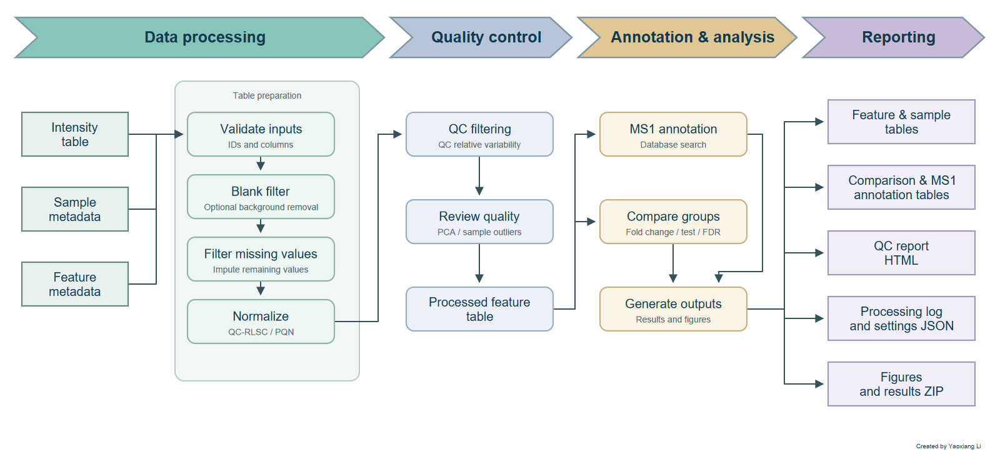

# omicsTools


An R package and Shiny app for omics data preparation, quality control,
mass spectrometry, analysis, and plotting.

Start with a sample intensity table and optional metadata. Use the app to
prepare data, review quality, compare groups, and export results, or call the
same tools directly from R.

<br clear="right" />

## Install and open

```{r, eval=FALSE}
install.packages("remotes")
remotes::install_github("cheemalab/omicsTools")
omicsTools::run_app()
```

## Available tools

| Task | Brief usage |
| --- | --- |
| Prepare data and compare groups | Upload tables in **Import & Preprocess**, or use `process_omics_data()` to validate, filter, impute, normalize, and compare. |
| MS1 annotation | Enter m/z values in **MS1 Annotation**, or call `ms1_annotation()` with a database, ion mode, and mass tolerance. |
| SCIEX/Qtrap QC | Import SCIEX exports in **SCIEX Pipeline** or use **7500/5500 Qtrap** for internal-standard normalization and QC review. |
| Calibration | Supply known concentrations and responses in **Targeted Calibration**, or use `fit_targeted_calibration()` and `predict_targeted_calibration()`. |
| Sample QC and metadata | Use `detect_sample_outliers()` on a numeric feature matrix, or `generate_sample_metadata()` to split sample names into fields. |
| Plots and exports | Use `plot_omics_pca()`, `plot_omics_heatmap()`, or `plot_peak_list()`. Export the workflow tables and QC report with `export_omics_results()`. |

The app includes PCA, heatmap, and LC-MS feature screens. Group comparisons
produce a volcano plot in the workflow results.

## Workflow



The workflow is available from the Import & Preprocess screen or directly in R.

## Run the workflow in R

Intensity tables use one row per sample. Sample metadata use the same sample
ID column. Feature metadata use feature_id, with optional mz and rt (seconds).

```{r, eval=FALSE}
result <- omicsTools::process_omics_data(
  intensities,
  sample_info = samples,
  feature_info = features,
  sample_type_col = "sample_type",
  blank_filter = TRUE,
  group_col = "group",
  reference = "control",
  comparison = "case"
)
omicsTools::export_omics_results(result, "results")
```

The results directory contains the intensity, sample, feature, comparison, QC,
and blank-filter tables, a processing record, settings, and an HTML QC report.
The report includes before/after PCA.

## MS1 annotation

```{r, eval=FALSE}
install.packages("cmmr")
omicsTools::ms1_annotation(
  c(181.07267, 203.05461),
  masstole = 10,
  toleUnit = "ppm",
  annotaDB = "hmdb",
  ionMode = "pos"
)
```

Optional packages provide MS1 searches (cmmr), Excel import (readxl),
Excel summaries (openxlsx), and ZIP exports (zip).

License: AGPL (>= 3).
